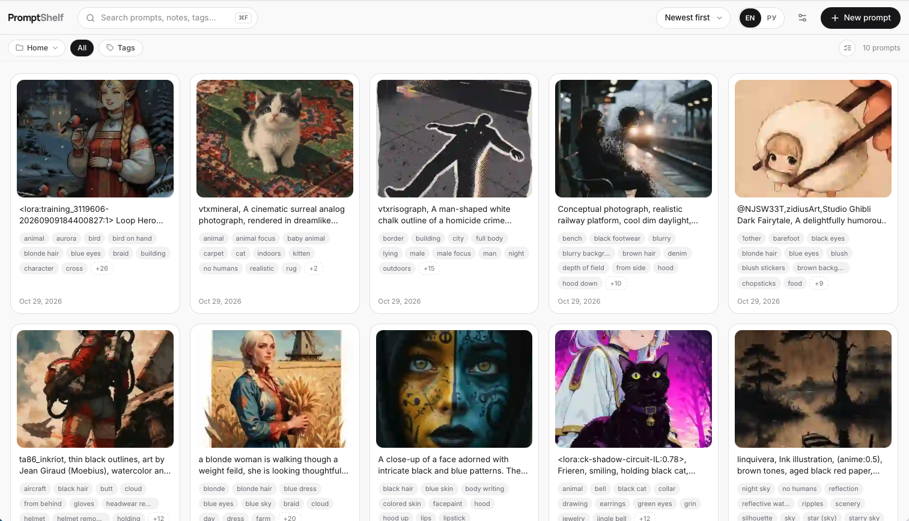

<div align="center">
  <sub><b><a href="README.en.md">English</a> · <a href="README.md">Русский</a></b></sub>
</div>

<div align="center">
  

  **Локальная библиотека промптов для macOS и Windows.**<br>
  Каждая карточка — текст промпта плюс изображения-результаты. Всё хранится на диске:
  никаких облаков, аккаунтов и внешних сервисов.

  <p>
    
    
    
    
    
    
  </p>

  
</div>

---

## 🎯 Зачем

Хорошие промпты на CivitAI нередко исчезают. Автор удаляет картинку или пост, чистит
галерею или уходит с платформы целиком. Вы сохраняли ссылку, чтобы вернуться к промпту
позже, а его уже нет — вместе с ним пропадают негативные теги и все параметры генерации.

PromptShelf создан как раз на этот случай. Один импорт из CivitAI — и картинка, промпт,
негативный промпт, LoRA, параметры (seed, sampler, шаги, CFG), автор и теги остаются
в вашей библиотеке на диске. Дальше чужая страница уже ни при чём: всё лежит локально
и никуда не денется.

## ✨ Возможности

- 🗂 **Карточки** — многострочный промпт, одно или несколько изображений, заметка, теги,
  оценка звёздами, даты.
- 🏷 **Негативный промпт** — отдельное поле в редакторе; в детальном просмотре показывается
  под промптом и копируется одной кнопкой.
- 🧲 **Импорт из CivitAI** — вставьте ссылку на картинку CivitAI: приложение само скачает
  изображение и заполнит карточку — промпт, негативный промпт, автор, чекпоинт, LoRA,
  параметры генерации (seed, sampler, шаги, CFG) и теги поста. Популярные теги сообщества
  подтягиваются через CivitAI API-ключ (задаётся в настройках).
- 🖼 **Умное сжатие при импорте** — изображение уменьшается до лимита длинной стороны
  (по умолчанию 1200 px) и пересжимается в JPEG или WebP с заданным качеством (по умолчанию 75%).
  Оригиналы не хранятся (опционально — «сохранять оригиналы» в настройках). Дополнительно
  создаётся миниатюра для быстрой сетки.
- 👁 **Просмотр** — сетка миниатюр + детальный просмотр (крупное фото, полный промпт,
  копирование одной кнопкой), навигация стрелками, полноэкранный зум по клику. Список LoRA
  у карточки с быстрым редактированием и удалением при наведении.
- 🔍 **Поиск и фильтры** — полнотекстовый поиск по промптам, заметкам и тегам; фильтр по тегам;
  сортировка по дате и оценке.
- 📚 **Группы** — карточка всегда лежит в одной группе. По умолчанию — группа «Home»/«Домашняя»,
  её нельзя удалить. Панель групп открывается чипом в панели фильтров: создание, переименование,
  удаление (карточки удаляемой группы возвращаются в дефолтную), переключение кликом, счётчик
  карточек у каждой группы. Текущая группа подсвечивается изумрудным — единственный цветовой
  акцент в интерфейсе.
- ☑️ **Мультивыбор** — переключатель «выделение» в панели фильтров; клики по плиткам
  добавляют/убирают карточки. Внизу появляется панель выделения: количество, «Переместить в…»,
  «Снять», «Готово».
- 🖱 **Drag & drop карточек в группы** — возьмите карточку, и панель групп выедет автоматически.
  Под курсором едет уменьшенная копия карточки с фото (при мультивыборе — с бейджем количества),
  плитка на полке «съёживается» и притухает. Все группы становятся целями: пунктирная изумрудная
  рамка и стрелка у каждой строки, строка под курсором заливается сплошным изумрудным.
  Отпустите — карточки переедут. Выделенные карточки можно также переносить кнопкой
  «Переместить сюда» в панели.
- 📋 **Вставка из буфера** — ⌘V / Ctrl+V вставляет скриншот или скопированный файл изображения
  прямо в новую карточку; текст промпта вставляется в поле как обычно.
- 📎 **Drag & drop файлов** — перетащите изображения в окно, и откроется новая карточка
  (приём файлов работает через HTML5-события webview, что позволяет сосуществовать
  с перетаскиванием карточек).
- 💾 **Импорт/экспорт** — вся библиотека выгружается одним файлом `.promptshelf`
  (zip: SQLite + изображения) для бэкапа или переноса на другую машину. Импорт заменяет
  текущую библиотеку.
- 📁 **Перенос библиотеки** — библиотеку можно скопировать в любую папку и переключиться
  на неё из настроек (вступает в силу после перезапуска, старая копия остаётся нетронутой).
- ⬆️ **Проверка обновлений** — кнопка в настройках сообщает о новой версии и устанавливает
  её: скачивание и перезапуск в два клика.
- 🌐 **Языки интерфейса** — английский и русский, переключатель в шапке.

## 📦 Установка

### Готовые сборки

Скачайте пакет со [страницы релизов](https://github.com/DoFFyVULF/PromptShelf/releases/latest):
универсальный `.dmg` для macOS и `.msi` / `setup.exe` для Windows.

### Сборка из исходников

```bash
npm install
npm run tauri build
```

Готовые дистрибутивы появятся в `src-tauri/target/release/bundle/`:

| Платформа | Файл                                 | Папка    |
| --------- | ------------------------------------ | -------- |
| macOS     | `PromptShelf_<версия>_aarch64.dmg`   | `dmg/`   |
| macOS     | `PromptShelf.app`                    | `macos/` |
| Windows   | `PromptShelf_<версия>_x64_en-US.msi` | `msi/`   |
| Windows   | `PromptShelf_<версия>_x64-setup.exe` | `nsis/`  |

**macOS** — откройте `.dmg` и перетащите PromptShelf в «Программы».

Приложение не подписано сертификатом Apple Developer, поэтому при первом запуске
Gatekeeper может заблокировать его. Варианты:

- Системные настройки → Конфиденциальность и безопасность → «Всё равно открыть»;
- или в терминале: `xattr -cr /Applications/PromptShelf.app`.

**Windows** — запустите `.msi` (или `-setup.exe`) и следуйте мастеру установки.
SmartScreen может показать предупреждение о неизвестном издателе: «Подробнее» →
«Выполнить в любом случае».

### Без установки (режим разработки)

```bash
npm run tauri dev
```

## ⌨️ Хоткеи

| Клавиши          | Действие                                        |
| ---------------- | ----------------------------------------------- |
| ⌘/Ctrl + N       | Новая карточка                                   |
| ⌘/Ctrl + V       | Вставить изображение из буфера                   |
| ⌘/Ctrl + F       | Фокус на поиск                                   |
| ⌘/Ctrl + C       | Копировать промпт (в детальном просмотре)        |
| ⌘/Ctrl + ,       | Настройки                                        |
| ← / →            | Предыдущая / следующая карточка                  |
| Esc              | Закрыть панель групп → просмотр → диалог/зум     |

## 🗃 Хранение

Библиотека живёт в стандартном каталоге данных приложения
(расположение можно изменить в настройках — приложение скопирует библиотеку
в выбранную папку):

- macOS: `~/Library/Application Support/app.promptshelf.desktop/`
- Windows: `%APPDATA%\app.promptshelf.desktop\`

```
library.db            # SQLite (карточки, изображения, теги, группы, настройки)
images/<uuid>.jpg     # сжатые изображения
images/<uuid>.t.webp  # миниатюры
images/originals/     # опциональные оригиналы
```

Экспорт: `.promptshelf` = ZIP со снимком `library.db` + папкой `images`.

## 🚀 Разработка

Требования: Node 20+, Rust 1.77+ (на Windows — MSVC Build Tools).

```bash
npm install
npm run tauri dev      # запуск в режиме разработки
npm run build          # проверка типов + сборка фронтенда
npm run tauri build    # сборка .app / .dmg / .msi / .exe
npm run icons          # перегенерировать набор иконок из app-icon.png
```

Только фронтенд (без нативного окна): `npm run dev` → http://localhost:5173

Тесты (сжатие, работа с карточками, миграции и т.д., всего 13):

```bash
cd src-tauri && cargo test --lib
```

Дизайн-система и описания UI-паттернов живут в `design-system/promptshelf/`.

## 🛠 Стек

| Слой      | Технологии                                                                                                                                                    |
| --------- | ------------------------------------------------------------------------------------------------------------------------------------------------------------- |
| Оболочка  | **Tauri 2** — нативное окно, IPC, диалоги. Drag & drop файлов — HTML5 внутри webview (нативный перехватчик Tauri отключён через `dragDropEnabled: false)`       |
| Backend   | **Rust**: `rusqlite` (bundled SQLite), `image` + `webp` (сжатие, EXIF-поворот), `arboard` (буфер обмена), `zip` (экспорт), `kamadak-exif`                        |
| Frontend  | **React 18 + TypeScript + Vite + Tailwind CSS 4**, иконки — Lucide, шрифты — Inter (UI) и Manrope (название в шапке), локально, кириллица + латиница             |

---

<div align="center">
  <sub>PromptShelf — промпты на своей полке 📚</sub>
</div>
